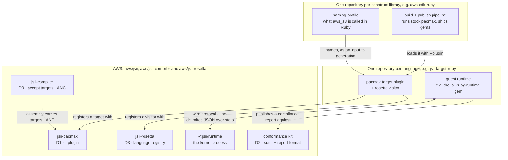

# A lightweight plugin system for jsii language targets

* **Original Author(s):**: @omarqureshi
* **Tracking Issue**: #1005
* **API Bar Raiser**: @mrgrain

jsii has no way to add a language without adding it to jsii itself, and the AWS CDK team will not take on more
in-tree languages (#935), so a community that builds bindings for its language today has to maintain forks of the
toolchain. This RFC proposes the smallest set of seams in jsii-compiler, jsii-pacmak and jsii-rosetta that let a
community build, publish and support a language target out of tree, with no language-specific code in any AWS
repository and no AWS support obligation.

## Working Backwards

### CHANGELOG

`aws/jsii-compiler`:

* feat: pass unknown target languages through, reported as JSII_4011

`aws/jsii` (jsii-pacmak):

* feat(jsii-pacmak): load external language targets with --plugin

`aws/jsii-rosetta`:

* feat: language plugins, and the translations corpus for them to test against

`aws/jsii` (documentation):

* docs: the kernel wire protocol is a public interface for alternative guest runtimes, and the compliance suite is
  published as a conformance kit

### README: Language plugins

jsii generates bindings for TypeScript, Python, Java, C# and Go. A language plugin lets anyone add another language
without changing jsii: the plugin is an npm package, published and maintained by its own community, that stock
`jsii-pacmak` and `jsii-rosetta` load on request.

> Plugin languages are community-built, community-hosted and community-supported. The jsii project supports the
> plugin API described here, not the plugins or the bindings they generate.

#### Generating bindings with a plugin

Install the plugin next to `jsii-pacmak` and name it with `--plugin`:

```sh
npm install --save-dev jsii-pacmak jsii-target-ruby
npx jsii-pacmak --plugin jsii-target-ruby -t ruby -o dist/ruby
```

A plugin target is generated for every package, whether or not its `package.json` configures that language, so you
can generate bindings for a library whose authors have never heard of the plugin. `--plugin` may be repeated, and
`--recurse` works as it does for the built-in targets:

```sh
npm install aws-cdk-lib
npx jsii-pacmak --plugin jsii-target-ruby -t ruby --recurse -o dist node_modules/aws-cdk-lib
```

To translate a library's examples into the plugin's language for its documentation, pass the same plugin to
`jsii-rosetta`:

```sh
npx jsii-rosetta extract --plugin jsii-target-ruby --cache-to dist/tablet.json node_modules/aws-cdk-lib
```

#### Configuring a library for a plugin language

A library may describe itself for a plugin language in its own `package.json`, exactly as it does for a built-in
one. The plugin defines and validates what goes inside:

```json
{
  "jsii": {
    "targets": {
      "ruby": { "gem": "acme-widgets", "module": "Acme::Widgets" }
    }
  }
}
```

The compiler passes the configuration through to the assembly and reports `JSII_4011` for any language it does not
know, so a typo such as `pyhton` is still visible. `JSII_4011` is a warning, so `--fail-on-warnings` fails the build
on it. A package that wants a hard error can ask for one:

```json
{ "jsii": { "diagnostics": { "JSII4011": "error" } } }
```

#### Writing a plugin

A plugin's default export declares its target for jsii-pacmak:

```ts
import { Target, TargetPluginDeclaration } from 'jsii-pacmak/lib/plugin-api';

class RubyTarget extends Target {
  // generateCode(), build(): see jsii-pacmak's built-in targets
}

export default {
  targetName: 'ruby',
  pluginApiVersion: '0.1.0',
  targetConstructor: RubyTarget,
} satisfies TargetPluginDeclaration;
```

`targetConstructor` runs through the same one-package-at-a-time builder as the built-in Go and Python targets. A
target that needs control of the whole build, as Java and .NET do, provides a `builderFactory` instead.

To translate examples, the plugin also registers a visitor with jsii-rosetta when it is loaded:

```ts
import { DefaultVisitor, registerTargetLanguage } from 'jsii-rosetta/lib/plugin-api';

class RubyVisitor extends DefaultVisitor<RubyContext> {
  // render each syntax node in Ruby
}

registerTargetLanguage(
  'ruby',
  {
    version: '1', // bump whenever the output changes; cached translations are keyed on it
    createVisitor: () => new RubyVisitor(),
  },
  { pluginApiVersion: '0.1.0' },
);
```

A plugin imports from `jsii-pacmak/lib/plugin-api` and `jsii-rosetta/lib/plugin-api` only. Everything else in those
packages is internal.

#### Versions and compatibility

Each plugin API is versioned by its `PLUGIN_API_VERSION`, and a plugin declares the version it was written against.
A plugin with an incompatible version is refused when it loads, with an error that names both versions. While an API
is 0.x it is experimental: any minor release may break plugins, so a plugin loads only when the major and minor
versions both match. From 1.0, the major versions must match and the plugin's minor version may not be newer.

#### Testing a plugin

Two test suites that gate the built-in languages are published for plugins to use:

* **The translations corpus** ships with jsii-rosetta, behind `jsii-rosetta/lib/testing/translations-corpus`. A
  plugin adds an expected-output file for each snippet in its own language, and runs the same snippets jsii-rosetta
  tests its built-in visitors against. A snippet added upstream shows up in the plugin as a skipped test until an
  expectation is written.
* **The conformance kit** is the jsii compliance suite, packaged to run against any guest runtime. A runtime that
  passes it can publish its report, and "passes the jsii conformance kit" is a claim anyone can check.

#### Starting a new language

The community-maintained `create-jsii-language` generates the whole shape of a language target: a pacmak plugin, a
rosetta visitor, a guest runtime with the kernel protocol stubbed out, the conformance kit wired to run against it,
and CI. A new runtime starts with every conformance test failing, and the kit orders the failures into a plan of work.

```sh
npx create-jsii-language crystal
```

---

Ticking the box below indicates that the public API of this RFC has been
signed-off by the API bar raiser (the `status/api-approved` label was applied to the
RFC pull request):

```
[ ] Signed-off by API Bar Raiser @mrgrain
```

## Public FAQ

### What are we launching today?

A plugin seam in the jsii toolchain. `jsii-pacmak --plugin` loads language targets published by their communities,
and `jsii-rosetta extract --plugin` loads their example translators. `jsii-compiler` passes target configuration for
unknown languages through to them. Each tool declares a versioned, experimental plugin API. The kernel wire protocol
is documented as a public interface for alternative guest runtimes, and the compliance suite and the translations
corpus are published for plugins to test against.

### Why should I use this feature?

If you maintain bindings for a language jsii does not ship, you can build them with stock jsii tools instead of a
fork, publish them on your own schedule, and back them with the same test suites the built-in languages pass.

If you use such a language, you get bindings whose quality you can check: a plugin's conformance report and corpus
results show where it stands.

### Is a plugin language a supported CDK language?

No. Supported languages are TS/JS and Python (plus the existing in-tree targets). Plugin languages are
community-built, community-hosted and community-supported. AWS supports only the seams this RFC adds.

### How do I know a community runtime actually works?

It publishes a conformance-kit report from the same suite that gates the in-tree languages. That is a stronger and
more checkable claim than most community bindings can make today.

### Does this only work for the AWS CDK?

No. The seams are part of jsii, so they work for any jsii library. The reference Ruby plugin generates and publishes
`aws-cdk-lib`, `constructs`, `cdk8s` and eight `cdk8s-plus-*` packages, unchanged between them.

### Where do plugin languages live?

Wherever their maintainers choose. The Open Constructs Foundation has been suggested as a natural home for languages
with a sustainable maintainer team.

### What may the generated packages be called?

Proposed rule: community publications to shared registries use a **`community-` prefix** on any AWS-branded name,
for example `community-aws-cdk-lib` and `community-constructs` on RubyGems, and the analogue in other ecosystems.
Provenance is then clear at a glance, and the canonical names stay reserved for AWS, including the option of granting
one to a plugin language later. Because it is a general rule rather than a judgement per name, no plugin language
needs to negotiate a name with AWS. The prefix applies to distribution names only; in-code namespaces (`AWSCDK::S3`
and so on) are unaffected. Self-hosted feeds, where the consumer explicitly opts into the source, may mirror the
canonical names. This rule needs AWS confirmation.

## Internal FAQ

### Why are we doing this?

RFC #935 proposed Ruby bindings for the AWS CDK in-tree, and was declined: usage outside TypeScript and Python is
marginal, and the Go experience showed that every in-tree language carries a permanent maintenance tail, including
forced breaking changes, whatever its adoption. In that discussion @mrgrain suggested the alternative this RFC
describes: "an RFC for a lightweight plugin-system that would allow you to publish a Ruby-plugin and self-host the
generated language bindings".

Working community implementations exist. The Ruby bindings pass the full jsii compliance suite, and production
workloads deploy through them. What keeps them in forks is that the toolchain's language registries are closed: the
Ruby fork's entire delta over upstream is registry entries and version pins. Without sanctioned seams, every
community language pays for rebases, patch-pins and drift, and AWS gets support ambiguity instead of a clear
boundary.

There is a second reason. An in-tree target inherits a syntax floor it does not control. Generated code has to keep
working on the oldest runtime AWS still supports, and raising that floor breaks every consumer of every CDK library
at once, so the floor follows the language's end-of-life schedule rather than its releases. jsii-pacmak's Python
target shows the cadence:

| Minimum Python | Since |
| --- | --- |
| 3.6 | March 2019 |
| 3.7 | April 2022 |
| 3.8 | November 2023 |
| 3.9 | February 2025 |
| 3.10 | May 2026 |

Python 3.10 shipped in October 2021, so `match`/`case` reached generated Python four and a half years after the
language had it. That lag is what supporting the oldest live runtime costs, and every in-tree language pays it. A
plugin maintainer sets the floor for their own community, and pays for moving it themselves.

### Why should we _not_ do this?

Published APIs are a commitment, and a plugin ecosystem could create support pressure ("my plugin broke"). Each seam
limits its commitment to one declared module, and nothing outside it is promised. jsii-pacmak's module is small and
mostly made of interfaces that are already stable. jsii-rosetta's is larger, because a visitor is built from
rosetta's syntax-tree machinery. Both start experimental, and the support boundary is stated in the Public FAQ and in
each tool's documentation.

A related worry is inheriting an abandoned ecosystem by association. The seams change what abandonment costs rather
than preventing it. An unmaintained plugin stops working for its own users and publishes no fresh conformance report,
while AWS's repositories, CI matrix and release train are exactly as they were. The reference implementation has one
maintainer today, which is precisely the risk this design keeps away from AWS: a single-maintainer target in tree
becomes AWS's liability the moment its maintainer stops, and as a plugin it simply stops being updated, visibly. Two
things narrow the risk for anyone depending on the bindings: the conformance kit measures where an implementation
actually stands, and an out-of-tree target can change hands without a toolchain change.

### What is the technical solution (design) of this feature?

Four deliverables, smallest first. Each opens an interface that already exists rather than adding a new one.

* **D0, jsii-compiler** ([Appendix A](#appendix-a-d0-jsii-compiler)): unknown `jsii.targets` languages pass through
  to the assembly instead of being rejected, and each is reported as a configurable warning, `JSII_4011`. Validation
  of the built-in languages is unchanged.
* **D1, jsii-pacmak** ([Appendix B](#appendix-b-d1-jsii-pacmak)): `--plugin` loads external targets. The generic
  `IndependentPackageBuilder` that already serves three built-in targets serves plugins too. A plugin target applies
  to every package, everything a plugin may import is declared in one versioned module, and the version is checked
  at load time.
* **D2, runtime conformance** ([Appendix C](#appendix-c-d2-runtime-conformance)): the kernel wire protocol is
  documented as a public interface for alternative guest runtimes, and the compliance suite is packaged as a runnable
  conformance kit. No code changes.
* **D3, jsii-rosetta** ([Appendix D](#appendix-d-d3-jsii-rosetta)): registered languages are translated everywhere a
  built-in one is, through one versioned plugin module, and the translations corpus ships with the package for plugins
  to test against.

Three parties own three separate things, and each depends only on the one beneath it:



No knowledge travels upward:

* **The toolchain knows nothing of the language.** A plugin registers itself, so even that happens on the community
  side. The D0, D1 and D3 changes contain no plugin language's name, which can be checked with grep.
* **The language target knows nothing of the library.** What `aws_s3` is called in Ruby is a fact about
  `aws-cdk-lib`, not about Ruby, so it lives in the library's own repository and reaches generation as an input. The
  reference target tests itself against a fabricated library, and the scaffold generates this split by default.
* **The kernel protocol is the one two-way interface**, because the kernel calls back into guest subclasses to make
  overrides work. Nothing language-specific crosses it: the kernel addresses objects by reference and has no
  per-language code path. The nearest exception is `JSII_AGENT`, a self-reported label that nothing branches on.

The `.jsii` assembly format and the kernel protocol do not change. D0 relaxes what the compiler accepts into the
`targets` field, which the format already types as open.

Appendices A to D describe each deliverable in detail, including what building the reference implementation
against it revealed. [Appendix E](#appendix-e-the-language-scaffold) describes the scaffold, and
[Appendix F](#appendix-f-reference-implementation) the reference implementation.

### Is this a breaking change?

No. Every change is additive or documentary. The built-in targets generate the same output: with D1 applied, all
1,972 of jsii-pacmak's generated-code snapshots are unchanged.

One behaviour relaxes. An unknown language in `jsii.targets` was an error and is now a warning (`JSII_4011`). A
build that relied on the error to catch a typo still fails with `--fail-on-warnings`, or with `JSII4011` raised to
an error in `jsii.diagnostics`.

### What alternative solutions did you consider?

#### In-tree language support

Proposed by RFC #935 and declined: every in-tree target is a permanent maintenance commitment regardless of adoption,
and it inherits the syntax floor described above.

#### No compiler change (D0 omitted)

Plugin naming would come only from a configuration overlay supplied at generation time, plus naming conventions.
This works, as the reference implementation shows, but third-party libraries could never describe themselves for a
plugin language in their own `package.json`, which every built-in target allows. A small pass-through that a package
can make fatal is the better trade, and the overlay remains for libraries that have never heard of a plugin.

#### Permanent forks (the status quo)

Forks work, as the Ruby fork demonstrates, but they pay a permanent rebase and patch-pin cost, leave the support
boundary unverifiable, and make every community language rediscover the architecture from scratch.

#### Discovering plugins from `package.json`

pacmak could load any installed package that declares itself a plugin. The `--plugin` flag records the operator's
intent and is trivial to script, and the reference pipeline never wanted implicit discovery. Discovery would also let
any dependency cause a code-generation plugin to load, a supply-chain surface the flag does not have. It can be
revisited at stabilization if real demand appears.

### What are the drawbacks of this solution?

* The experimental plugin APIs can break plugins between releases. Explicit versioning makes the break loud at load
  time, but a plugin that lags stops working.
* jsii-rosetta's plugin API is large, because it is drawn from what one visitor needed. A second language may need
  more, which is the main reason it starts experimental.
* jsii-rosetta's language registry is module state, so a plugin and the jsii-pacmak that loads it must resolve the
  same copy of jsii-rosetta. If they resolve two copies, examples silently stay TypeScript. A plugin installed from
  npm alongside pacmak resolves one copy as a matter of course, and the reference plugin reports the mismatch loudly
  at load time.
* The conformance kit and the corpus are artifacts AWS publishes and has to keep coherent.
* A `community-` ecosystem, once seeded, will create expectations around naming, discovery and eventually
  graduation, which need the governance answers listed under open issues.

### What is the high-level project plan?

Every deliverable exists as a working branch, rebased on current upstream `main`, and a production deployment has
been running on them via forks. The plan is to land them in this order:

1. This RFC.
2. **D0**, [aws/jsii-compiler#2830](https://github.com/aws/jsii-compiler/pull/2830) (draft). The full compiler suite
   passes (440 tests).
3. **The `--recurse` fix**, [aws/jsii#5274](https://github.com/aws/jsii/pull/5274) for
   [aws/jsii#5275](https://github.com/aws/jsii/issues/5275), on its own ahead of D1. It is a bug in released
   jsii-pacmak that every target hits on installed packages, independent of this RFC.
4. **D1**, [aws/jsii#5276](https://github.com/aws/jsii/pull/5276) (draft). The full pacmak suite passes (190 tests),
   with all built-in snapshots unchanged.
5. Re-home `jsii-target-ruby` onto the released seams and retire the fork pins.
6. **D2**: the protocol statement and the conformance kit; Ruby publishes its report.
7. Re-extract `create-jsii-language` from the Ruby plugin's final structure. Community-hosted; the Ruby plugin
   doubles as its reference.
8. **D3**, [aws/jsii-rosetta#3878](https://github.com/aws/jsii-rosetta/pull/3878) (draft). The full rosetta suite
   passes (576 tests). D3 is sequenced last only so that D1 stays small to review; until it lands, a plugin's bindings
   work with their examples left in TypeScript.
9. Close the superseded in-tree PRs (aws/jsii#5178, aws/jsii-compiler#2663, aws/aws-cdk#38248,
   aws/jsii-rosetta#3710), which already point here.

Both plugin APIs stay experimental until:

* a second, independently maintained language target builds against them;
* a full upstream release cycle passes with no breaking plugin-API change;
* the conformance kit and the corpus have external consumers.

A stabilization review then decides whether to freeze them at 1.0.

### Are there any open issues that need to be addressed later?

* **Naming and branding.** The `community-` prefix rule in the Public FAQ needs AWS confirmation, and a hosting
  organization may prefer its own prefix (for example `ocf-`). Self-hosted feeds mirroring the canonical names is
  already exercised in production.
* **Parallel-build output isolation.** jsii-pacmak builds each dependency batch concurrently and assumes each package
  has its own output directory. A target whose packages share an output tree, as Ruby's do (one `lib/` for
  single-path installs), has to serialize its own copy phase. This works plugin-side; the open question is whether the
  plugin contract documents it as the target's responsibility or jsii-pacmak gains a per-target concurrency setting.
* **A configuration overlay flag.** Naming for libraries that carry no plugin-language configuration is supplied by
  the plugin at generation time, with no jsii-pacmak change. A `--target-config` flag would give every plugin the same
  command-line story, but nothing depends on it.
* **The generated-code snapshot harness.** jsii-pacmak's snapshot test for its built-in targets cannot be imported by
  a plugin, so each plugin rebuilds it ([Appendix B](#appendix-b-d1-jsii-pacmak)). Exporting it would remove that
  duplication.

## Appendix

### Appendix A: D0, jsii-compiler

Since [aws/jsii-compiler#2415](https://github.com/aws/jsii-compiler/pull/2415) (November 2025), `validateTargets`
rejects any `jsii.targets` language outside the built-in list (`Unknown target language: ruby`), at both the
`package.json` level and the submodule level, since every `.jsiirc.json` goes through the same function. That check
exists to catch typos, and it should keep doing so. For unknown languages, though, it makes configuring a library for
a plugin language impossible.

With D0, unknown languages pass through instead of throwing. Their configuration must still be an object. Each is
reported as a new diagnostic, `JSII_4011` (`jsii-config/unknown-target-language`), naming the language and where it
was declared. Validation of the built-in languages is unchanged, and `targets.ruby` reaches the assembly for the
plugin to validate against its own schema: validation belongs at generation time, in the plugin that owns the schema.

It is a diagnostic rather than a log line so that typo-catching survives. `--fail-on-warnings` fails on it, and
`jsii.diagnostics` can raise it to an error; a log line reaches neither. For the same reason the assembler reports
it, not `package.json` loading: a package's severity overrides are applied after loading, and `--fail-on-warnings`
reads only the compiler's own diagnostics.

### Appendix B: D1, jsii-pacmak

Today jsii-pacmak's targets are a closed map (`ALL_BUILDERS: { [key in TargetName]: BuilderFactory }`). Three of the
five built-ins (`go`, `js`, `python`) already run through a generic `IndependentPackageBuilder` parameterized only by
a `TargetConstructor`, which is the abstraction a plugin needs. D1 opens the registry rather than adding a framework.

* **Loading.** `--plugin <npm-package-or-path>` loads a module whose default export declares `targetName`,
  `pluginApiVersion`, and either a `targetConstructor` or, for targets that need multi-module builds like Java and
  .NET, a full `builderFactory`. Plugin names may not collide with built-in targets or with each other. Ruby is the
  hardest packaging case attempted so far (a native gem build, and one output tree shared across the closure), and it
  never needed builder-level control, so `targetConstructor` is the expected route.
* **Target selection.** A plugin target is generated for every package, whether or not its assembly configures the
  language. Built-in targets generate only for packages that configure them, unless `--force-target` is passed. That
  filter cannot apply to plugin languages, because libraries are not expected to configure them, and loading a plugin
  is already an explicit opt-in. With no `--targets`, plugin targets are generated alongside the built-ins.
* **The declared API.** `jsii-pacmak/lib/plugin-api` exports everything a plugin may use: the declaration and its
  version contract, `Target` and `Generator`, the `builderFactory` types, and two helpers the built-in targets use
  (`subprocess`, `assertSpecIsRosettaCompatible`). That is exactly what the reference plugin imports. Every other
  jsii-pacmak module stays internal.
* **The version contract.** `PLUGIN_API_VERSION` is `0.1.0`. A plugin must declare `pluginApiVersion`; while the API
  is 0.x, jsii-pacmak loads it only if the major and minor versions both match, and from 1.0 only if the majors match
  and the plugin's minor version is not newer.
* **No version or naming hooks.** `toReleaseVersion` and similar functions are only called from inside each
  language's generator, so a plugin brings its own mapping. The Ruby plugin owns release-version conversion, range
  translation, its runtime-pairing constraint and an exact-pin publishing mode, with no jsii-pacmak changes.
* **Naming without library configuration.** Libraries will not carry configuration for community languages, so the
  plugin supplies naming at generation time: module names per assembly and submodule, acronym casing and so on,
  merged over whatever the assembly declares. The Ruby plugin merges a profile of 328 explicit submodule names plus
  acronym data, selected through an environment variable, and builds the whole published `aws-cdk-lib` closure that
  way in CI.

#### What building against it revealed

**A plugin cannot reuse the generated-code snapshot harness.** jsii-pacmak tests its own targets by generating the
`jsii-calc` fixtures and comparing the output with a committed snapshot, which catches a refactor that quietly
changes hundreds of generated files. A plugin cannot use it: `verifyGeneratedCodeFor` is keyed on the `TargetName`
enum, and jsii-pacmak publishes only `lib/`. The Ruby plugin reimplements it in about 150 lines, pinning 370 files,
and the scaffold ships a copy for every new target. Exporting the harness, as D3 does for the translations corpus,
would remove that duplication. It is not required by anything else in this RFC.

**`--recurse` deadlocked on installed packages.** A plugin's natural input is the installed npm tree: install
`aws-cdk-lib`, point jsii-pacmak at it with `--recurse`, and generate the closure. On released jsii-pacmak that fails
for every target, including Python:

```
$ npm install aws-cdk-lib
$ npx jsii-pacmak --recurse -t python -o dist node_modules/aws-cdk-lib
Error: Could not determine ordering between: @aws-cdk/asset-awscli-v1,
       @aws-cdk/asset-node-proxy-agent-v6, aws-cdk-lib
```

`findJsiiModules` ordered modules by `devDependencies` as well as `dependencies` and `peerDependencies`. Published
manifests keep their `devDependencies`, and the `@aws-cdk/asset-*` packages devDepend on `aws-cdk-lib` for their
tests, so the installed closure has a cycle. A devDependency cannot affect generated bindings, so it should not be an
ordering edge. It went unnoticed because `--recurse` was used inside source monorepos, where the devDependency graph
happens to give a workable order. The fix is independent of this RFC and was submitted on its own
([aws/jsii#5274](https://github.com/aws/jsii/pull/5274)). With it, installing the library and running jsii-pacmak
with `--plugin` and `--recurse` is the entire generation step for a plugin's pipeline.

### Appendix C: D2, runtime conformance

A guest runtime needs no plugin API. The kernel wire protocol (line-delimited JSON over stdio to `@jsii/runtime`) is
already the boundary, and every released guest runtime depends on its stability. D2 makes that contract explicit:

* a documented statement that the kernel protocol is a public interface for alternative guest runtimes, with its
  compatibility policy;
* `tools/jsii-compliance` published as a runnable conformance kit: the canonical suite definition and the report
  format, so any runtime can produce a compliance report and make a verifiable claim without AWS running anything;
* the suite definition extended with what each test proves and which runtime capability it exercises.

#### Why a kit is more than the suite file

Packaging `tools/jsii-compliance` as it stands would give a new runtime 123 test names and a report format: enough to
state a claim, not enough to do the work.

* **The suite is mostly names.** `TestCase` has a `description`, and 98 of the 123 are empty. The only way to learn
  what `objectIdDoesNotGetReallocatedWhenTheConstructorPassesThisOut` asserts is to find the same test in another
  runtime and read it.
* **Failures are not independent.** One missing mechanism fails every test that depends on it, so a new runtime opens
  on 123 failures describing about a dozen areas of work, in no useful order. The Ruby runtime was built by inferring
  that structure: kernel before values before collections, interfaces and error propagation before synchronous
  callbacks, and those before the async completion protocol. Nothing in the suite records it.

Neither gap needs a toolchain change. `create-jsii-language` already ships both: the suite grouped into eleven
capabilities with prerequisites, every test described in one line, and a planner that reads a compliance report and
names the capability to work on next. The descriptions were read from the existing reference implementations, and the
catalogue is validated against the Ruby runtime's report: 123 of 123, with the two sets exactly equal. It is offered
upstream as part of D2 so that it is maintained in one place, and so the published compliance matrix can group by
capability.

The proposed packaging follows the corpus in D3: the kit ships with the package it belongs to and rides the jsii
release train, exposes a small library API, and jsii's own compliance tests consume that API. There is no separate
release cadence to govern.

### Appendix D: D3, jsii-rosetta

Rendered API documentation is part of a credible language target, and documentation needs translated examples, so D3
is a committed deliverable. The Ruby plugin's visitor translates examples into Ruby, and a rendered documentation
site is generated and published from the bindings today.

* **Registration.** `registerTargetLanguage(language, factory, { pluginApiVersion })` makes a language resolvable
  everywhere a built-in one is. Language ids are plain strings and tablets are keyed by them, so no format changes.
  Registering the same language and visitor version again does nothing, since a plugin registers when it is loaded;
  a different version is an error.
* **The declared API.** `jsii-rosetta/lib/plugin-api` exports registration and its version contract, under the same
  rule as D1, and the syntax-tree machinery a visitor is built from: `DefaultVisitor`, `AstRenderer`, `OTree` and
  about twenty AST and jsii helpers. That set is exactly what the Ruby visitor imports. The package's `exports` map
  exposes this module and the corpus harness, and nothing else under `lib/`.
* **Loading.** `extractSnippets({ pluginModules })`, and `jsii-rosetta extract --plugin` on the command line, load a
  plugin in the main process and in every translation worker. Paths are resolved from the caller's working directory.
* **`prepare(context)`.** An optional hook on the visitor factory tells a language which assemblies it is translating
  for. No built-in language implements it.
* **The translations corpus.** The corpus moves from `test/translations` to `corpus/` and ships with the package,
  behind `lib/testing/translations-corpus`: snippet enumeration, compilation against the fixture assemblies, and the
  comparison normalizers. jsii-rosetta's own translation tests use the same API, so the shipped corpus cannot drift
  from what the repository tests. The corpus is about 2 MB; a separate package remains possible if that weight is a
  concern.

#### What building against it revealed

Opening the language map was necessary but not sufficient. Building the Ruby plugin surfaced three places that
assumed a fixed set of languages:

| Assumption | Effect on a plugin language |
| --- | --- |
| `Translator.translate` defaulted its language list to the built-in enum | the language was resolvable but never translated; callers got the TypeScript source back |
| translation runs in a worker pool, and workers are fresh module contexts | a language registered in the main thread did not exist in any worker, so everything `extract` produced omitted it |
| the cache check compared only built-in languages | a library's shipped tablet counted as a hit for a language it had never been translated for, so those snippets were copied out untranslated |

None of them produced an error; each gave plausible output, such as a successful build or a 125 MB tablet, that was
missing the language. The third is the clearest:
extracting translations for `aws-cdk-lib` finished in 70 seconds and wrote a tablet with 37 Ruby translations out of
21,394 snippets, because every snippet already in the shipped tablet was treated as a cache hit. Each fix is small:
consult the registry rather than the enum, and let callers name modules for workers to load.

Loading needed one more correction. A language has to be registered both in the main process, where the cache is
checked, and in every worker. As two separate steps, forgetting the first brought the cache failure back, so one
option now does both. Its paths, and the assembly locations, are resolved before they reach a worker: a worker would
resolve a module from jsii-rosetta's own install, and translation runs from a temporary directory.

A fourth finding is the reason the seam needs designing rather than only opening: a worker could be told to load a
language, but not what it was translating for. No built-in language needs the assemblies, because Java and C# reach
a type through a namespace import, and none of them renders an enum member differently from a static property. A
language where those differ has no other source for the answer, because a published example does not typecheck: the
fixtures it relies on are not shipped. In Ruby the live case is module resolution. CDK's conventional import aliases
mostly do not name their submodule (`firehose` is `aws_kinesisfirehose`, `sfn` is `aws_stepfunctions`), and only the
assembly knows where `DeliveryStream` is declared. Without a supported route, the plugin passed the assemblies
through an environment variable: a side channel the contract did not describe. `prepare(context)` replaces it. It
carries assembly locations rather than loaded assemblies, since an assembly runs to tens of megabytes and each worker
should read only what it needs.

These were all caught by checking translated output, not by an error, which is the case for shipping the corpus: it
is to translation what the conformance kit is to the runtime protocol.

### Appendix E: The language scaffold

`create-jsii-language` is a community deliverable, not an AWS commitment. It is a template repository and a small
initializer that generate, for a named language:

| Scaffold artifact | Sourced from (Ruby reference) |
| --- | --- |
| pacmak plugin package: `Target` skeleton, version mapping, naming utilities, snapshot harness against the `jsii-calc` fixtures | the ~2,300-line Ruby target and its snapshot suite |
| guest-runtime skeleton: kernel process management, the wire verbs stubbed, serialization, callback and override layout, error taxonomy | the runtime gem's `kernel`, `serializer`, `callbacks` and `registry` structure, the same shape in every existing guest language |
| the conformance kit wired to run against the skeleton, with every test failing, plus the capability catalogue and planner from Appendix C | the compliance suite; making it pass is how the Ruby runtime was built |
| naming-profile template and documented format | the maintained profile for `aws-cdk-lib`'s 613 submodules |
| CI and publishing templates: generate bindings, publish to a community feed, smoke-test the published package by synthesizing a real stack | the operating Ruby publish pipeline |
| decision checklists: member casing, reserved words, module mapping, version mapping, callback ergonomics | the recorded Ruby design decisions |

The scaffold cannot generate the hard part, a serializer and callback machinery that are correct in the target
language. It generates the proven structure, the protocol contract as failing conformance tests, and a working
reference to learn from. A second language, `jsii-target-crystal`, has been generated from it and builds. That shows
the scaffold works; it is not a second working target, since Crystal has no generator implementation yet.

### Appendix F: Reference implementation

The Ruby implementation is extracted from the existing fork: a pacmak target of about 2,300 lines and a rosetta
visitor of about 1,100 lines, re-homed behind D1 and D3 as the `jsii-target-ruby` plugin package.

* Through stock jsii-pacmak with `--plugin`, it generates the `jsii-calc` fixture closure. Every generated file passes
  `ruby -c`, and a complete `.gem` builds with the embedded assembly.
* The repository hosts the runtime gem and runs the full jsii compliance suite against it through the published
  `@jsii/runtime`: 123 of 123 cases (379 RSpec examples).
* It uses the rosetta corpus by adding only `.rb` expectation files.
* Generated `aws-cdk-lib` bindings are published on a public gem feed with rendered API documentation, and
  production workloads (a Rails application on Lambda) deploy through them.
* The same plugin, unchanged, generates and publishes `constructs`, `cdk8s` and eight `cdk8s-plus-*` packages:
  twelve documented libraries in all. cdk8s shares none of the AWS CDK's naming, packaging or deployment model, so it
  exercises the seam rather than one library's assumptions. A cdk8s app writes YAML without a cloud account, so CI
  synthesizes the same chart from Ruby and from TypeScript and compares the manifests.

Every repository involved is public:

| Repository | Holds | This RFC changes |
| --- | --- | --- |
| `omarqureshi/aws-cdk-ruby` | what `aws-cdk-lib` is called in Ruby, and its packaging | nothing |
| `omarqureshi/cdk8s-ruby` | the same for `cdk8s` and eight `cdk8s-plus-*` packages | nothing |
| `omarqureshi/constructs-ruby` | the same for `constructs` | nothing |
| `omarqureshi/rubygems.omarqureshi.net` | the community feed and rendered API documentation | nothing |
| `omarqureshi/jsii-target-ruby` | the pacmak target plugin, the rosetta visitor and the Ruby guest runtime | consumes the seams below |
| `omarqureshi/create-jsii-language` | the scaffold | nothing |
| `omarqureshi/jsii-target-crystal` | unmodified scaffold output, kept as evidence it builds | nothing |
| `aws/jsii-compiler` | assembly compilation and validation | D0 |
| `aws/jsii`: `jsii-pacmak` | binding generation | D1 |
| `aws/jsii`: `@jsii/runtime` | the kernel process every guest runtime talks to | nothing; the protocol is documented as public (D2) |
| `aws/jsii`: `tools/jsii-compliance` | the compliance suite and report format | D2: published as a runnable kit, no code changes |
| `aws/jsii-rosetta` | example translation | D3 |

### Appendix G: Possibilities this leaves open

None of these is proposed here.

* **Several eras of one language.** Language ids are free-form strings, so `ruby` and `ruby-next` can coexist in one
  registry, one tablet and one build. A maintainer can emit modern syntax while an older era stays available, and
  because the target is out of tree, that era can be handed to a different maintainer. The language's own packaging
  hides this from users: a gemspec's `required_ruby_version` makes RubyGems pick the newest compatible release.
* **Moving a built-in target out of tree.** Once a language can live outside the toolchain, a built-in target is a
  plugin that happens to ship in the repository, and could be moved out without changing its output. That would not
  mean withdrawing support: the same team could own it from its own repository, with its own release cadence and
  syntax floor. Terraform moving providers out of core, and Kubernetes moving cloud providers and volume plugins to
  CCM and CSI, are precedents for the shape of that decision, not for the decision itself.
* **Graduation.** A plugin language with sustained quality and adoption could be granted a canonical distribution
  name, dropping the `community-` prefix. AWS can decide that per language, later.
* **More languages.** With the scaffold and the conformance kit, a language such as Crystal, Elixir, PHP or Swift is
  an engineering project with a measurable finish line rather than a research project.
* **A hosting home.** An Open Constructs Foundation home for plugin languages would give consumers a recognizable
  trust anchor between "AWS-supported" and "someone's fork".
